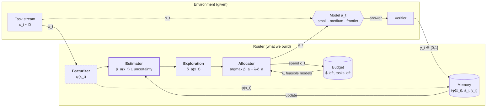

# The routing model

Theory and architecture only. Implementation and results live in [part1.md](part1.md) and [part2.md](part2.md). Sources are in [references.md](references.md).

## Setup

- Tasks $x_1, \dots, x_T \overset{\text{iid}}{\sim} \mathcal{D}$. Each $x_t$ is the text of a task, such as a hardware design spec. The router sees only this text.
- Models $\mathcal{M} = \{s, m, f\}$ (small, medium, frontier) with known per-token prices $\pi^{\text{in}}_a, \pi^{\text{out}}_a$, rising with size.
- A call costs $c_a(x) = \pi^{\text{in}}_a\, n^{\text{in}}(x) + \pi^{\text{out}}_a\, n^{\text{out}}_a(x)$. The output length $n^{\text{out}}_a(x)$ includes thinking and is known only after the call returns, so costs are random. A cap on output length bounds each call by $\bar c_a$.
- A hard budget $B$ for the whole stream.
- Unknown pass rates $p_a(x) = \Pr[\text{model } a \text{ solves } x] \in [0, 1]$.
- At step $t$, the router sees $x_t$ and the history $H_{t-1} = \{(x_i, a_i, y_i, c_i)\}_{i<t}$, then picks one model $a_t$.
- The verifier returns $y_t \sim \text{Bernoulli}(p_{a_t}(x_t))$. We see $y_t$ only for the model we called (bandit feedback). The verifier is the grader: the router can't run it or read it.

## Objective

$$
\max_{\pi}\ \mathbb{E}\Big[\sum_{t=1}^T y_t\Big] = \mathbb{E}\Big[\sum_{t=1}^T p_{a_t}(x_t)\Big]
\quad\text{s.t.}\quad \sum_{t=1}^T c_{a_t}(x_t) \le B \ \text{ on every run}.
$$

Every task must get a call, and a call's cost is known only afterwards. So at step $t$ the router may pick $a$ only if its worst case still leaves the cheapest model's worst case for each task to come:

$$
\sum_{i < t} c_i + \bar c_a + \bar c_{\min}\,(T - t) \le B.
$$

This is a **contextual bandit with a knapsack constraint**: rewards are unknown and learned from bandit feedback, prices are known but token counts vary, and the budget is shared across the stream. Each single step is one item of an online multiple-choice knapsack: pick one of three items for task $x_t$.

## Pricing the budget

Relaxing the budget with a price $\lambda \ge 0$ per dollar splits the problem into one choice per task:

$$
a_t = \arg\max_{a \in \mathcal{M}}\ \hat p_a(x_t) - \lambda\, \hat c_a(x_t),
$$

where $\hat c_a(x)$ is the expected cost of the call.

$\lambda$ is the pass rate one dollar must buy to be worth spending. With two models this is a threshold on the upgrade gain: call the bigger model when $\hat p_{\text{big}}(x) - \hat p_{\text{small}}(x) \ge \lambda\,(\hat c_{\text{big}}(x) - \hat c_{\text{small}}(x))$.

$\lambda$ is set so that spending tracks the budget. Pacing does this by dual descent on the cost each call actually incurred. Raise $\lambda$ when a call costs more than the remaining budget per remaining task, and lower it when a call costs less:

$$
\lambda \leftarrow \max\Big(0,\ \lambda + \eta\,\Big(c_t - \frac{B_{\text{left}}}{T_{\text{left}}}\Big)\Big).
$$

## Where routing gains come from

**If pass rates don't depend on the task**, $p_a(x) = p_a$, then only *how many* tasks each model gets matters, not *which*. The best policy is a fixed mix, found by a three-variable linear program:

$$
\max_{n}\ \sum_a n_a\, p_a \quad\text{s.t.}\quad \sum_a n_a = T,\ \ \sum_a n_a c_a \le B .
$$

Here $c_a$ is the average cost of a call to $a$.

**Routing as swaps.** Suppose $B/T = c_m$, so always-medium spends the budget exactly. Starting from always-medium, routing means swaps: $k = (c_f - c_m)/(c_m - c_s)$ downgrades to small pay for one upgrade to frontier. A swap that upgrades $x$ and downgrades $y_1, \dots, y_k$ pays off when

$$
\underbrace{p_f(x) - p_m(x)}_{\text{upgrade gain}} \;>\; \underbrace{\sum_{j=1}^{k} \big(p_m(y_j) - p_s(y_j)\big)}_{\text{downgrade losses}} .
$$

The price ratios set $k$. When small is nearly free compared with the others, $k \approx 1$, and each upgrade costs one downgrade.

So routing beats the best fixed mix only if both of these hold:

1. **The gains vary.** Upgrade gains $p_f - p_m$ and $p_m - p_s$ differ across tasks. Some tasks gain a lot from a bigger model, and others (easy or hopeless ones) gain almost nothing.
2. **The router can see the variation.** Text features $\phi(x)$ predict which tasks are which. Variation that $\phi(x)$ can't see is worth nothing to any router.

## Four levels of knowledge

Let $q_a(x) = \mathbb{E}[\,p_a(x') \mid \phi(x') = \phi(x)\,]$ be the best pass-rate estimate available from the features alone.

| level | knows | sees future tasks? | problem |
|---|---|---|---|
| **Offline oracle** | $p_a(x)$ | yes | offline knapsack, solved exactly |
| **Text oracle** | $q_a(x)$ | yes | offline knapsack on the best text-based estimates |
| **Online text oracle** | $q_a(x)$ | no | online knapsack: only $\lambda$ is unknown |
| **Learning router** | $H_{t-1}$ only | no | online knapsack + learning $\hat p$ |

**Offline oracle.** We solve the multiple-choice knapsack exactly with a dynamic program on expected costs. Here $b$ is the remaining budget and $u_a(x)$ is the expected cost of calling $a$ on $x$, rounded to a fine grid of budget units:

$$
V_t(b) = \max_{a:\ u_a(x_t) \le b}\ p_a(x_t) + V_{t+1}(b - u_a(x_t)), \qquad V_{T+1}(b) = 0 \ \text{ for all } b \ge 0.
$$

The text oracle runs the same program with $q_a$ in place of $p_a$, and is scored on the true $p_a$. With real models, $q_a$ isn't known either. We estimate it with a supervised predictor that sees every model's result on every *other* task (full information, cross-validated). That is the best a router trained offline on the same features could do.

**Regret splits into three parts:**

$$
V_{\text{oracle}} - V_{\text{router}}
= \underbrace{(V_{\text{oracle}} - V_{\text{text}})}_{\text{invisible to } \phi}
+ \underbrace{(V_{\text{text}} - V_{\text{online text}})}_{\text{unknown future}}
+ \underbrace{(V_{\text{online text}} - V_{\text{router}})}_{\text{cost of learning}} .
$$

Only the last part is the router's fault. The first is set by the featurizer and the task distribution. The text oracle, not the offline oracle, is the realistic ceiling.

**Measuring.** Score a run by its expected passes $\sum_t p_{a_t}(x_t)$, not the verifier's draws $\sum_t y_t$. Both have the same mean, but the expected passes drop the noise of individual draws. With real models, $p_a(x)$ is estimated from several recorded attempts per (task, model).

## Several calls per task

A *strategy* replaces the single model choice. It calls models, runs checks on their outputs, and submits one output to the grader. The simplest shape is a cascade:

1. Make a cheap first attempt, costing $c_1$. It may be several calls at once, such as two designs to compare.
2. Run a check on it. The check accepts with probability $\alpha$, and accepted outputs pass with rate $q_{\text{acc}}$.
3. On rejection, escalate. The escalation costs $c_{\text{esc}}$ and passes with rate $q_{\text{esc}}$ on the rejected tasks. It can be a fresh call to a bigger model, or a *judge*: a model shown the rejected attempts and the evidence against them, which writes the output to submit.

Its value and expected cost per task are

$$
V = \alpha\, q_{\text{acc}} + (1 - \alpha)\, q_{\text{esc}},
\qquad
C = c_1 + (1 - \alpha)\, c_{\text{esc}} .
$$

A cascade beats a single call to model $a$ when $V \ge p_a$ and $C \le c_a$. Three things make that possible:

- **A cheap first attempt.** A small model that solves most tasks keeps $c_1$ low.
- **A sharp check.** $q_{\text{acc}}$ near 1, so accepted outputs are trustworthy, and a small $1 - \alpha$, so escalation is rare.
- **Escalation where it's needed.** The rejected tasks are the hard ones, so $q_{\text{esc}}$ is lower than the escalation model's average.

**Checks see what the text can't.** A pre-call router decides from $\phi(x)$ alone. A check decides after an attempt, so it can use the attempt itself. When the text predicts little (a weak text oracle), the attempt is where the signal is.

**Correlated failures cap a check.** Two attempts that agree can still both be wrong if the models misread the task the same way. If $\beta$ is the probability that both are wrong *and* agree, then $\alpha\,(1 - q_{\text{acc}}) = \beta$. No amount of agreement among similar models removes $\beta$. Only a check whose errors are independent of the first attempt's can.

**Parallel vs sequential.** Calls whose results are always needed (the two designs to compare) cost the same in parallel or in sequence, so running them together saves a round for free. Calls needed only sometimes (the escalation) are cheaper in sequence: in parallel, they are paid for on every task. Without a latency term in the objective, a strategy should parallelise only what it always needs.

## Architecture



Thick border: learned online. Dashed border: frozen.

Each step: featurize the task, estimate each model's pass rate, add exploration, then pick the model with the best pass rate minus its priced cost among those still affordable. After the call, the verifier's result goes into memory. A result never helps the task it came from. It helps only future tasks that look similar, so the featurizer decides what "similar" means.

### Featurizer

$\phi$ is a pretrained text-embedding model, frozen. A short stream is far too small to train one. The featurizer sets the text oracle: a better $\phi$ makes more of the variation in upgrade gains visible.

### Estimator and memory

The memory holds what we know about how each model did on past tasks. The estimator reads it before each call, and the verifier's result is written back after.

| estimator | memory | $\hat p_a(x)$ | strengths | weaknesses |
|---|---|---|---|---|
| Per-model average | passes / tries per model | Beta posterior per model, ignores $x$ | learns the best fixed mix | no per-task routing |
| Clusters | centroids + passes / tries per (cluster, model) | Beta posterior of $x$'s nearest cluster | pools results per task type | must pick the number of clusters |
| Nearest neighbours | every past $(\phi(x_i), a_i, y_i)$ | similarity-weighted pass rate of past tasks sent to $a$ | no training, keeps all detail | sparse: results split across models |
| Logistic per model | weights $w_a$ | $\sigma(w_a^\top \phi(x))$ | standard contextual bandit | 3 weight vectors; needs lots of data |
| Shared difficulty (IRT) | abilities $\theta_a$, difficulty head $w$ | $\tfrac12 + \tfrac12\sigma(\theta_a - w^\top\phi(x))$ | every result, from any model, trains one shared difficulty | assumes all models find the same tasks hard |
| LLM difficulty probe | none | ask a model how hard $x$ is | strong signal on real tasks | costs a call; poorly calibrated |

A cluster scoreboard looks like this:

```
cluster 3 (combinational):  small 9/10   medium 5/5   frontier 2/2
cluster 7 (FSMs):           small 1/4    medium 2/6   frontier 7/8
```

**Priors matter at small $T$.**

- *Shrinkage.* A cluster's cell starts from the model's overall pass rate, not from $\tfrac12$. This is a hierarchical prior: $\text{Beta}(\kappa\,\bar p_a + \text{passes},\ \kappa\,(1 - \bar p_a) + \text{fails})$, with strength $\kappa$.
- *Ordering.* Costlier models are rarely worse, so a prior with $p_s \le p_m \le p_f$ is cheap and safe. With a flat prior, the cost penalty $\lambda c_a$ makes the cheapest model look best before any data arrives.

**Learning gains, not levels.** The allocator acts on upgrade gains, such as $p_f(x) - p_m(x)$. Estimating a gain in a region needs results from both models there. Shared-difficulty models get gains from structure instead: one difficulty estimate moves all three models' pass rates at once.

### Exploration

We only observe $y_t$ for $a_t$, so the allocator decides which data the estimator gets. Exploring costs budget and passes.

- **Greedy:** use $\hat p$ as is.
- **ε-greedy:** pick a random affordable model with probability ε.
- **Thompson sampling:** draw $\tilde p$ from the posterior and use it in place of $\hat p$.
- **UCB:** use an optimistic upper bound on $\hat p$.

### Allocator

- **Fixed $\lambda$**, set from a guess of the task mix.
- **Pacing:** dual descent on $\lambda$, as above.
- **Re-solve:** each step, solve the knapsack for the remaining budget, using past tasks as a stand-in for future ones.

## Scaling: 100 tasks vs 1M

| | 100 tasks | 1M tasks |
|---|---|---|
| Estimator | shared difficulty (IRT), clusters with shrinkage | classifier per model on embeddings, or a small fine-tuned router model |
| Nearest neighbours | too sparse | works well with a fast vector index |
| Featurizer | frozen | can be fine-tuned for routing |
| Exploration | costly, every task counts | explore randomly on the first ~1%, train offline, then deploy |
| $\lambda$ | rough online guess | estimated almost exactly; online ≈ offline |
| New risk | not enough data | the task mix drifts over time, so retrain regularly |

With little data, strong assumptions are cheap and noise is expensive, so use simple models that pool every result. With lots of data, noise averages out, so let the model learn the fine detail.
