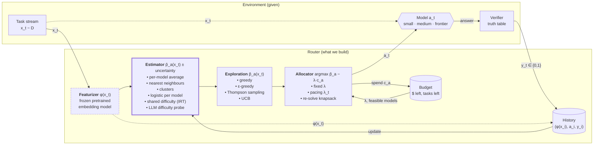

# Part 1: the model

## Setup

- Tasks $x_1, \dots, x_T \overset{\text{iid}}{\sim} \mathcal{D}$, with $T = 100$. Each $x_t$ is the text of a true/false question.
- Models $\mathcal{M} = \{s, m, f\}$ with costs $c_s = 0.25$, $c_m = 0.5$, $c_f = 1$.
- Budget $B = T/2 = 50$.
- Unknown pass rates $p_a(x) = \Pr[\text{model } a \text{ answers } x \text{ correctly}] \in [\tfrac12, 1]$. A coin flip already scores $\tfrac12$.
- At step $t$, the router sees $x_t$ and the history $H_{t-1} = \{(x_i, a_i, y_i)\}_{i<t}$, then picks one model $a_t$.
- The verifier returns $y_t \sim \text{Bernoulli}(p_{a_t}(x_t))$. We see $y_t$ only for the model we called (bandit feedback).

## Objective

$$
\max_{\pi}\ \mathbb{E}\Big[\sum_{t=1}^T y_t\Big] = \mathbb{E}\Big[\sum_{t=1}^T p_{a_t}(x_t)\Big]
\quad\text{s.t.}\quad \sum_{t=1}^T c_{a_t} \le B \ \text{ on every run}.
$$

The budget is a hard limit. Every task must get a call, so at step $t$ the router may only pick models that leave enough for the cheapest call on each task still to come:

$$
\sum_{i \le t} c_{a_i} + c_{\min}\,(T - t) \le B.
$$

## Two parts: estimator and allocator

**Estimator.** It learns $\hat p_a(x) \approx p_a(x)$ from $H_{t-1}$.

**Allocator.** It takes $\hat p$ and the remaining budget, and picks $a_t$. Relaxing the budget with a price $\lambda \ge 0$ per dollar splits the problem into one choice per task:

$$
a_t = \arg\max_{a \in \mathcal{M}}\ \hat p_a(x_t) - \lambda\, c_a .
$$

Pick $\lambda$ so that spending tracks the budget. Raise $\lambda$ when spending runs ahead of pace, and lower it when it falls behind.

## System



Thick border: learned online. Dashed border: frozen, not learned.

### Memory

The memory is the History box: what we know about how each model did on past questions. The estimator reads it before each call, and the verifier's result is written back after.

**Option A: k-means (compressed memory).** Keep a short list of question types, each with a scoreboard.

```
cluster 3 (sports):  small 9/10   medium 5/5   frontier 2/2
cluster 7 (law):     small 1/4    medium 2/6   frontier 7/8
```

- Each cluster has a centroid (the centre of its questions in embedding space) and, for each model, passes / tries.
- **Read:** embed the new question, find the nearest centroid, and estimate $\hat p_a$ from that row, e.g. Beta$(1 + \text{passes},\ 1 + \text{fails})$.
- **Decide:** pick $\arg\max_a \tilde p_a - \lambda c_a$, with $\tilde p$ drawn from the Beta posterior (Thompson sampling).
- **Write:** add the pass or fail to that row's scoreboard, and nudge the centroid toward the new question. If no centroid is close, start a new cluster.
- How k-means finds the clusters: drop $K$ centroids, assign each question to its nearest one, move each centroid to the mean of its questions, and repeat until they stop moving.

**Option B: k-nearest neighbours (raw memory).** Keep every past question as its own row: $(\phi(x_i), a_i, y_i)$.

- **Read:** find the $k$ past questions closest to the new one that were sent to model $a$. Estimate $\hat p_a$ as their pass rate, with a prior for models that have few neighbours.
- **Decide:** same as Option A.
- **Write:** append the new row. Nothing else changes.

**Trade-off.** k-NN keeps all the detail but spreads 100 results across 3 models, so each lookup sees only a few results. k-means pools results per question type, so each estimate rests on more data. With only 100 questions, that favours k-means.

**One sentence:** the memory is a short list of question types, each with a scoreboard of how every model did on that type. We look up the closest type, route by its scoreboard, then write the result back.

Each step: featurize the task, estimate each model's pass rate, add exploration, then pick the model with the best pass rate minus its priced cost among those still affordable. After the call, the verifier's result goes into the history, and the estimator learns from it. A result never helps the task it came from, because that task is already gone. It helps only future tasks that look similar, so the featurizer decides what "similar" means.

### Featurizer

$\phi$ is a pretrained text-embedding model, frozen. 100 tasks are far too few to train or fine-tune one. All learning happens in the estimator on top of $\phi(x)$, so the embedding model decides what "similar tasks" means.

### Estimator choices

| estimator | $\hat p_a(x)$ | strengths | weaknesses |
|---|---|---|---|
| Per-model average | Beta posterior per model, ignores $x$ | baseline; learns the best fixed mix | no per-task routing |
| Nearest neighbours (memory) | mean of $y$ over the $k$ most similar past tasks sent to $a$ | simple, no training | sparse: 100 tasks split across 3 models |
| Clusters | cluster $\phi(x)$, Beta posterior per (cluster, model) | matches tier structure | must pick the number of clusters; new clusters start cold |
| Logistic per model | $\sigma(w_a^\top \phi(x))$ | standard contextual bandit | 3 separate weight vectors; needs lots of data in high dimensions |
| Shared difficulty (IRT) | $\tfrac12 + \tfrac12\sigma(\theta_a - w^\top\phi(x))$ | every result, from any model, trains one shared difficulty head; most data-efficient | assumes all models find the same tasks hard |
| LLM difficulty probe | ask a model how hard $x$ is, or read its confidence | strong signal on real tasks | costs a call; no signal in the simulation |

With only 100 tasks, data efficiency matters most. That favours the per-model average as a baseline, clusters, and shared difficulty.

### Exploration choices

- **Greedy:** use $\hat p$ as is.
- **ε-greedy:** pick a random affordable model with probability ε.
- **Thompson sampling:** draw $\tilde p$ from the posterior.
- **UCB:** use an optimistic upper bound on $\hat p$.

### Allocator choices

- **Fixed price $\lambda$**, set from a guess of the task mix.
- **Pacing:** adjust $\lambda$ after each call so spending tracks $B \cdot t / T$.
- **Re-solve:** each step, solve the knapsack for the remaining budget, using past tasks as a stand-in for future ones.

## Three levels of knowledge

| | knows $p$? | sees future tasks? | problem |
|---|---|---|---|
| **Offline oracle** (`OracleRouter`) | yes | yes | offline knapsack, solved exactly |
| **Online oracle** | yes | no | online knapsack: only $\lambda$ is unknown |
| **Our router** | no | no | online knapsack + learning $\hat p$ |

**Offline oracle.** For each task, pick one of three models: a multiple-choice knapsack. We solve it exactly with a dynamic program. Here $b$ is the remaining budget and $u_a = c_a / c_{\min}$ is each model's cost in units of the cheapest call:

$$
V_t(b) = \max_{a:\ u_a \le b}\ p_a(x_t) + V_{t+1}(b - u_a), \qquad V_{T+1}(b) = 0 \ \text{ for all } b \ge 0.
$$

This is the ceiling. Its gap to our router splits into the cost of not knowing the future and the cost of not knowing $p$.

**Learning is coupled to allocating.** We only observe $y_t$ for $a_t$, so the allocator decides which data the estimator gets. Exploring (calling a model to learn about it) costs budget and passes. Thompson sampling handles this in a simple way: draw $\tilde p \sim$ posterior, then use $\tilde p$ in place of $\hat p$ in the allocator.

## Where routing gains come from

Suppose each model's pass rate does not depend on the task: $p_a(x) = p_a$ for every $x$. The models still differ from each other. Then it doesn't matter *which* tasks a model gets, only *how many*, and routing has nothing to learn per task. The best policy is a fixed mix found by a three-variable linear program:

$$
\max_{n}\ \sum_a n_a\, p_a \quad\text{s.t.}\quad \sum_a n_a = T,\ \ \sum_a n_a c_a \le B .
$$

Routing beats this only when the *upgrade gains* $p_f(x) - p_m(x)$ and $p_m(x) - p_s(x)$ vary across tasks. If they vary, we spend budget where the gain per dollar is largest. The current simulation varies them very little, which is why all-medium nearly matches the oracle.

## Simulation

Each task has a hidden tier $z(x)$, and $p_a(x) = P[z(x), a]$:

| tier | share | small | medium | frontier | best model |
|---|---|---|---|---|---|
| easy | 30% | 0.95 | 0.97 | 0.98 | small |
| medium | 30% | 0.60 | 0.92 | 0.95 | medium |
| hard | 25% | 0.52 | 0.60 | 0.92 | frontier |
| hopeless | 15% | 0.50 | 0.52 | 0.55 | small |

- Sending each tier to its best model costs $51.25 per 100 tasks, just over $B$. So the router must also trade tiers off.
- Tasks are clustered into 10 topics by their embeddings $\phi(x)$, and each topic gets a random difficulty. Tiers are cut from a score that is half topic difficulty and half noise. The embedding therefore carries some signal about the tier, but not all of it.

## What is implemented today

| component | status | code |
|---|---|---|
| Task stream | 100 BoolQ validation questions | `routing/tasks.py`, `data/boolq_100.jsonl` |
| Verifier | holds the answer key; routers can't read it | `routing/tasks.py` |
| Simulated models | per-question pass rates from the tier table; topic tiers via k-means on embeddings | `routing/models.py` |
| Featurizer | frozen `BAAI/bge-small-en-v1.5`, vectors cached to disk | `routing/features.py` |
| Budget | hard limit; always holds back the cheapest call for each question left | `routing/budget.py` |
| Episode runner | one call per question; stops with an error on overspend | `routing/episode.py` |
| Baselines | always small, always medium, frontier-first | `routing/routers.py` |
| Offline oracle | exact dynamic program over the true pass rates; the ceiling | `routing/routers.py` |
| Comparison | runs every router over 20 shuffled streams | `main.py` |

**Not built yet:** the estimator (memory), exploration, and the λ allocator. Together they make the learning router. It plugs into the existing `Router` interface: `choose` reads the memory and applies the allocator, and `update` writes the verifier's result back.

**Not run yet:** the embedding cache needs a one-time model download, which the sandbox blocks. Until it runs (`uv run python main.py`), the topic-tier simulation and the router tests can't run. With length-based tiers, the oracle reached 0.864 against 0.801 for always-medium, so a learning router has about 6 points to win.

## Scaling: 100 questions vs 1M

| | 100 questions | 1M questions |
|---|---|---|
| Estimator | shared difficulty (IRT), clusters with shrinkage | classifier per model on embeddings, or a small fine-tuned router model |
| k-NN | too sparse | works well with a fast vector index |
| Featurizer | frozen | can be fine-tuned for routing |
| Exploration | costly, every question counts | explore randomly on the first ~1%, train offline, then deploy |
| λ | rough online guess | estimated almost exactly; online ≈ offline |
| New risk | not enough data | the question mix drifts over time, so retrain regularly |

With little data, strong assumptions are cheap and noise is expensive, so use simple models that pool every result. With lots of data, noise averages out, so let the model learn the fine detail.
