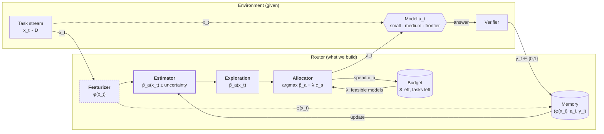

# The routing model

Theory and architecture only. Implementation and results live in [part1.md](part1.md) and [part2.md](part2.md).

## Setup

- Tasks $x_1, \dots, x_T \overset{\text{iid}}{\sim} \mathcal{D}$. Each $x_t$ is the text of a true/false question.
- Models $\mathcal{M} = \{s, m, f\}$ (small, medium, frontier) with known costs $c_s < c_m < c_f$.
- A hard budget $B$ for the whole stream.
- Unknown pass rates $p_a(x) = \Pr[\text{model } a \text{ answers } x \text{ correctly}] \in [\tfrac12, 1]$. A coin flip already scores $\tfrac12$.
- At step $t$, the router sees $x_t$ and the history $H_{t-1} = \{(x_i, a_i, y_i)\}_{i<t}$, then picks one model $a_t$.
- The verifier returns $y_t \sim \text{Bernoulli}(p_{a_t}(x_t))$. We see $y_t$ only for the model we called (bandit feedback).

Running example: $T = 100$, $c = (0.25,\ 0.5,\ 1)$, $B = 50$.

## Objective

$$
\max_{\pi}\ \mathbb{E}\Big[\sum_{t=1}^T y_t\Big] = \mathbb{E}\Big[\sum_{t=1}^T p_{a_t}(x_t)\Big]
\quad\text{s.t.}\quad \sum_{t=1}^T c_{a_t} \le B \ \text{ on every run}.
$$

Every task must get a call, so at step $t$ the router may only pick models that leave enough for the cheapest call on each task still to come:

$$
\sum_{i \le t} c_{a_i} + c_{\min}\,(T - t) \le B.
$$

This is a **contextual bandit with a knapsack constraint**: rewards are unknown and learned from bandit feedback, costs are known, and the budget is shared across the stream. Each single step is one item of an online multiple-choice knapsack: pick one of three items for task $x_t$.

## Pricing the budget

Relaxing the budget with a price $\lambda \ge 0$ per dollar splits the problem into one choice per task:

$$
a_t = \arg\max_{a \in \mathcal{M}}\ \hat p_a(x_t) - \lambda\, c_a .
$$

$\lambda$ is the pass rate one dollar must buy to be worth spending. With two models this is a threshold on the upgrade gain: call the bigger model when $\hat p_{\text{big}}(x) - \hat p_{\text{small}}(x) \ge \lambda\,(c_{\text{big}} - c_{\text{small}})$.

$\lambda$ is set so that spending tracks the budget. Pacing does this by dual descent. Raise $\lambda$ when a call costs more than the remaining budget per remaining task, and lower it when a call costs less:

$$
\lambda \leftarrow \max\Big(0,\ \lambda + \eta\,\Big(c_{a_t} - \frac{B_{\text{left}}}{T_{\text{left}}}\Big)\Big).
$$

## Where routing gains come from

**If pass rates don't depend on the task**, $p_a(x) = p_a$, then only *how many* tasks each model gets matters, not *which*. The best policy is a fixed mix, found by a three-variable linear program:

$$
\max_{n}\ \sum_a n_a\, p_a \quad\text{s.t.}\quad \sum_a n_a = T,\ \ \sum_a n_a c_a \le B .
$$

**Routing as swaps.** In the running example, $B/T = c_m$, so always-medium spends the budget exactly. Starting from always-medium, routing means swaps: two downgrades to small pay for one upgrade to frontier. A swap that upgrades $x$ and downgrades $y$ and $z$ pays off when

$$
\underbrace{p_f(x) - p_m(x)}_{\text{upgrade gain}} \;>\; \underbrace{\big(p_m(y) - p_s(y)\big) + \big(p_m(z) - p_s(z)\big)}_{\text{downgrade losses}} .
$$

So routing beats the best fixed mix only if both of these hold:

1. **The gains vary.** Upgrade gains $p_f - p_m$ and $p_m - p_s$ differ across tasks. Some tasks gain a lot from a bigger model, and others (easy or hopeless ones) gain almost nothing.
2. **The router can see the variation.** Text features $\phi(x)$ predict which tasks are which. Variation that $\phi(x)$ can't see is worth nothing to any router.

## Four levels of knowledge

Let $q_a(x) = \mathbb{E}[\,p_a(x') \mid \phi(x') = \phi(x)\,]$ be the best pass-rate estimate available from the features alone.

| level | knows | sees future tasks? | problem |
|---|---|---|---|
| **Offline oracle** | $p_a(x)$ | yes | offline knapsack, solved exactly |
| **Text oracle** | $q_a(x)$ | yes | offline knapsack on the best text-based estimates |
| **Online text oracle** | $q_a(x)$ | no | online knapsack: only $\lambda$ is unknown |
| **Learning router** | $H_{t-1}$ only | no | online knapsack + learning $\hat p$ |

**Offline oracle.** We solve the multiple-choice knapsack exactly with a dynamic program. Here $b$ is the remaining budget and $u_a = c_a / c_{\min}$ is each model's cost in units of the cheapest call:

$$
V_t(b) = \max_{a:\ u_a \le b}\ p_a(x_t) + V_{t+1}(b - u_a), \qquad V_{T+1}(b) = 0 \ \text{ for all } b \ge 0.
$$

The text oracle runs the same program with $q_a$ in place of $p_a$, and is scored on the true $p_a$.

**Regret splits into three parts:**

$$
V_{\text{oracle}} - V_{\text{router}}
= \underbrace{(V_{\text{oracle}} - V_{\text{text}})}_{\text{invisible to } \phi}
+ \underbrace{(V_{\text{text}} - V_{\text{online text}})}_{\text{unknown future}}
+ \underbrace{(V_{\text{online text}} - V_{\text{router}})}_{\text{cost of learning}} .
$$

Only the last part is the router's fault. The first is set by the featurizer and the task distribution. The text oracle, not the offline oracle, is the realistic ceiling.

**Measuring.** In simulation, score a run by its expected passes $\sum_t p_{a_t}(x_t)$, not the verifier's draws $\sum_t y_t$. Both have the same mean, but the expected passes drop the coin-flip noise of the verifier.

## Architecture



Thick border: learned online. Dashed border: frozen.

Each step: featurize the task, estimate each model's pass rate, add exploration, then pick the model with the best pass rate minus its priced cost among those still affordable. After the call, the verifier's result goes into memory. A result never helps the task it came from. It helps only future tasks that look similar, so the featurizer decides what "similar" means.

### Featurizer

$\phi$ is a pretrained text-embedding model, frozen. A short stream is far too small to train one. The featurizer sets the text oracle: a better $\phi$ makes more of the variation in upgrade gains visible.

### Estimator and memory

The memory holds what we know about how each model did on past questions. The estimator reads it before each call, and the verifier's result is written back after.

| estimator | memory | $\hat p_a(x)$ | strengths | weaknesses |
|---|---|---|---|---|
| Per-model average | passes / tries per model | Beta posterior per model, ignores $x$ | learns the best fixed mix | no per-task routing |
| Clusters | centroids + passes / tries per (cluster, model) | Beta posterior of $x$'s nearest cluster | pools results per question type | must pick the number of clusters |
| Nearest neighbours | every past $(\phi(x_i), a_i, y_i)$ | similarity-weighted pass rate of past tasks sent to $a$ | no training, keeps all detail | sparse: results split across models |
| Logistic per model | weights $w_a$ | $\sigma(w_a^\top \phi(x))$ | standard contextual bandit | 3 weight vectors; needs lots of data |
| Shared difficulty (IRT) | abilities $\theta_a$, difficulty head $w$ | $\tfrac12 + \tfrac12\sigma(\theta_a - w^\top\phi(x))$ | every result, from any model, trains one shared difficulty | assumes all models find the same tasks hard |
| LLM difficulty probe | none | ask a model how hard $x$ is | strong signal on real tasks | costs a call; poorly calibrated |

A cluster scoreboard looks like this:

```
cluster 3 (sports):  small 9/10   medium 5/5   frontier 2/2
cluster 7 (law):     small 1/4    medium 2/6   frontier 7/8
```

**Priors matter at small $T$.**

- *Shrinkage.* A cluster's cell starts from the model's overall pass rate, not from $\tfrac12$. This is a hierarchical prior: $\text{Beta}(\kappa\,\bar p_a + \text{passes},\ \kappa\,(1 - \bar p_a) + \text{fails})$, with strength $\kappa$.
- *Ordering.* Costlier models are rarely worse, so a prior with $p_s \le p_m \le p_f$ is cheap and safe. With a flat prior, the cost penalty $\lambda c_a$ makes the cheapest model look best before any data arrives.

**Learning gains, not levels.** The allocator acts on upgrade gains, such as $p_f(x) - p_m(x)$. Estimating a gain in a region needs results from both models there. Shared-difficulty models get gains from structure instead: one difficulty estimate moves all three models' pass rates at once.

### Exploration

We only observe $y_t$ for $a_t$, so the allocator decides which data the estimator gets. Exploring costs budget and passes.

- **Greedy:** use $\hat p$ as is.
- **ε-greedy:** pick a random affordable model with probability ε.
- **Thompson sampling:** draw $\tilde p$ from the posterior and use it in place of $\hat p$.
- **UCB:** use an optimistic upper bound on $\hat p$.

### Allocator

- **Fixed $\lambda$**, set from a guess of the task mix.
- **Pacing:** dual descent on $\lambda$, as above.
- **Re-solve:** each step, solve the knapsack for the remaining budget, using past tasks as a stand-in for future ones.

## Scaling: 100 questions vs 1M

| | 100 questions | 1M questions |
|---|---|---|
| Estimator | shared difficulty (IRT), clusters with shrinkage | classifier per model on embeddings, or a small fine-tuned router model |
| Nearest neighbours | too sparse | works well with a fast vector index |
| Featurizer | frozen | can be fine-tuned for routing |
| Exploration | costly, every question counts | explore randomly on the first ~1%, train offline, then deploy |
| $\lambda$ | rough online guess | estimated almost exactly; online ≈ offline |
| New risk | not enough data | the question mix drifts over time, so retrain regularly |

With little data, strong assumptions are cheap and noise is expensive, so use simple models that pool every result. With lots of data, noise averages out, so let the model learn the fine detail.

## Related work

| source | what it does | link to this model |
|---|---|---|
| [RouteLLM](https://arxiv.org/abs/2406.18665) | strong-vs-weak routing from preference data; threshold $\alpha$ on $P(\text{strong wins} \mid x)$ | $\alpha$ is $\lambda$ for two models. Its best router (matrix factorisation) shares structure across models, and it transfers to unseen model pairs: evidence for one shared difficulty. |
| [LLMRouterBench](https://arxiv.org/abs/2601.07206) | 400K instances, 33 models, 10 routers under one protocol | A k-means × model accuracy table ties neural routers. Embedding choice moves results ~1 point. The best routers capture domain structure, not per-query structure, which is the gap between the text oracle and the offline oracle. |
| [Routing and cascading survey](https://arxiv.org/abs/2603.04445) | taxonomy: when the decision is made, what signals, how computed | We are pre-generation and online, using the query, model metadata and feedback, computed by a bandit. Closest: PILOT (online multiple-choice knapsack), UniRoute (cost-adjusted cluster error). Cascades use answer-level signals. |
| [The Souq](https://robvc.com/research/the-souq) | market structure of model routing on OpenRouter | Capability routing (which model) vs execution routing (which provider). Ranking by quality minus cost is our Lagrangian, and $\lambda$ is the market price of a dollar. |
| [Workload-Router-Pool](https://arxiv.org/abs/2603.21354) | vision for routing in LLM serving fleets | Separates signal extraction from the decision. Its per-(model, domain) Beta scoreboard is our cluster memory, and it names too few samples per cell as the main limit. |
