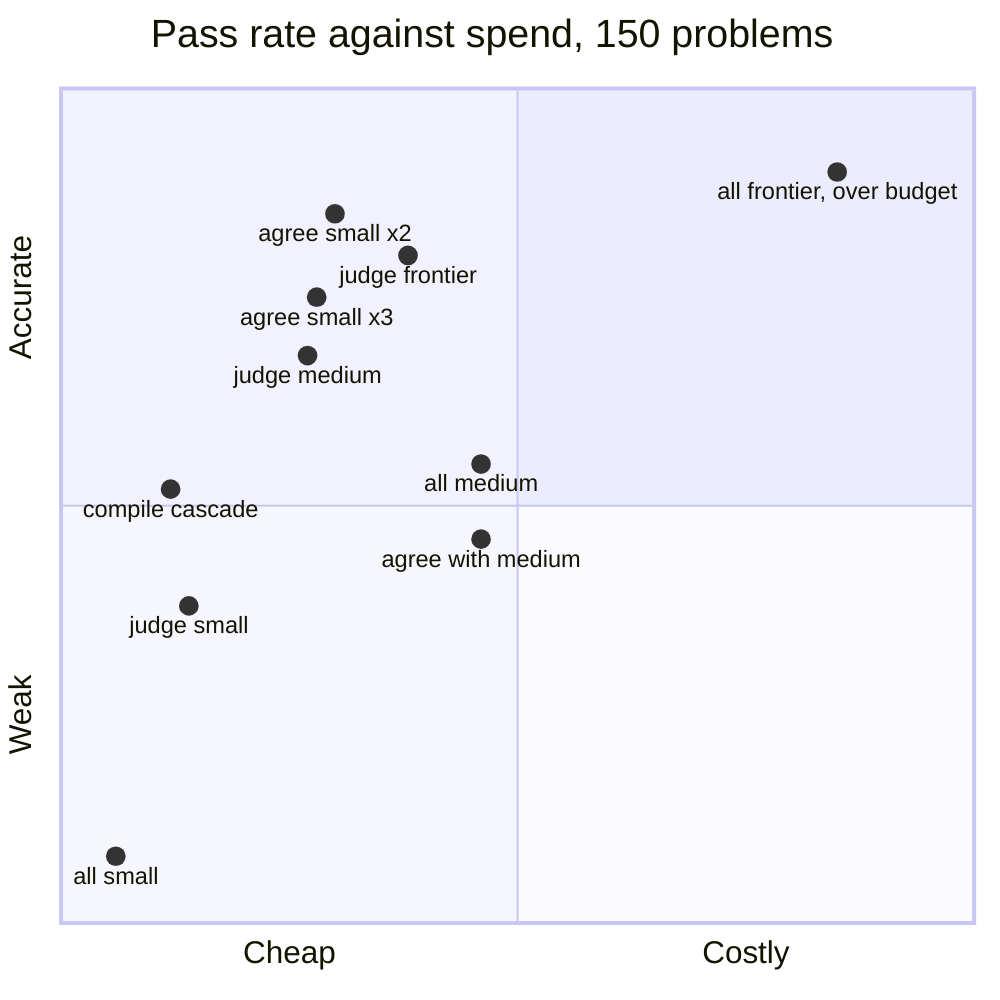
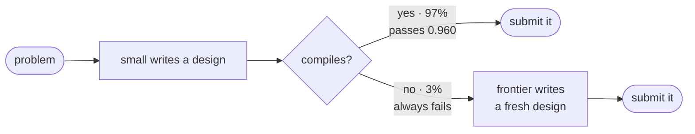
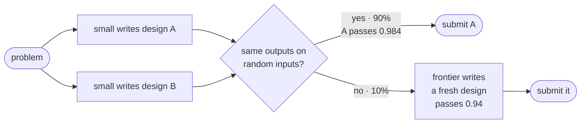
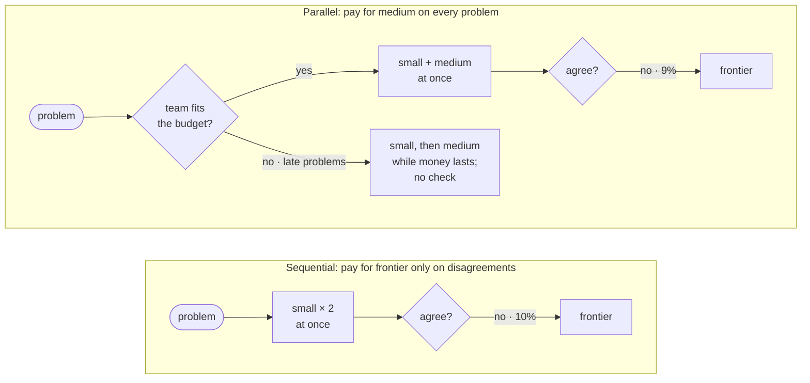
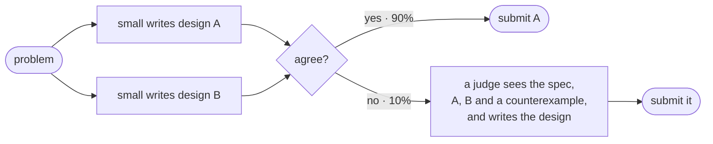
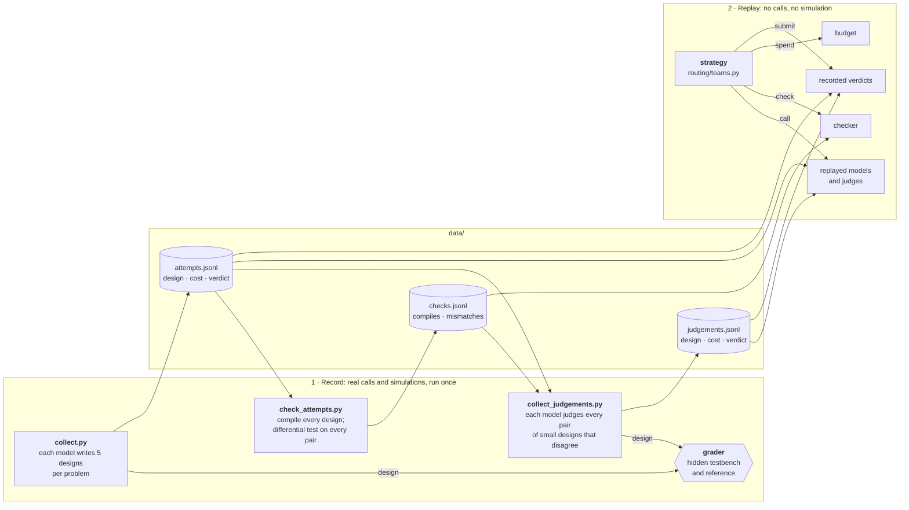

# Part 2: teams of agents per problem

Same as Part 1, but each problem may get several model calls, from a team of up to 4 agents that can pass results to each other. The total budget is the same: $0.55 for the 150 VerilogEval problems. The model and its notation are in [math-model.md](math-model.md) (see "Several calls per task"); sources are in [references.md](references.md).

## Conclusions

1. **A first attempt plus a check carries the signal the spec text lacked.** Two small designs written at once and compared on random inputs reach **0.981**. If they agree, the team submits one; if not (about 10% of problems), it escalates to frontier. That beats Part 1's best single-call strategy (always-medium, 0.963) and Part 1's held-out oracle (0.972), and spends 60% of the budget. Frontier on every problem would reach 0.984 for about $0.94, 1.7× the budget.
2. **The cheapest useful check is a second cheap design.** When two small designs agree, small's pass rate rises from 0.935 to 0.984. A compile check alone is perfectly reliable but rarely fires; it still takes always-small (0.935) to 0.961 for a quarter of the budget.
3. **More agents is not better.** Three small designs do worse than two (0.975): there are more pairs that can agree wrongly, and fewer problems escalate. Adding medium to the team runs out of money, so late problems fall back to a single unchecked call.
4. **Talking does not beat a fresh call.** A judge shown both disagreeing designs and a counterexample is never better than calling frontier afresh, at any model size:
   - Small and medium judges are cheaper but much less accurate.
   - A frontier judge costs 1.7× a fresh frontier design and is slightly less accurate. Seeing two candidates, it sometimes picks the wrong one or breaks the right one.
   
   The counterexample helps only when *both* small designs are wrong (frontier judge 0.72 against 0.67 for a fresh design), and that case is rare.
5. **What's left is correlated failure.** The best team's 1.9% of failures are mostly problems where two small designs agree on the same wrong design (1.4%). No amount of agreement between small designs catches these. The rest are problems where frontier fails after an escalation (0.5%).
6. **Parallelism pays only for calls that are always needed.** The two small designs cost the same in parallel or in sequence, so running them together saves a round for free. Paying for a bigger model in parallel on every problem doesn't fit the budget.

**For a production router:** spend the budget *after* a cheap attempt, not before it. Generate twice cheaply, compare by simulation, and escalate the disagreements to the strongest model with a fresh prompt. Don't route on the spec text, and don't ask a model to referee.

## At a glance

Every strategy, by pass rate and spend. Higher and further left is better. Spend runs from $0 to $1.10, so the vertical midline is the $0.55 budget: everything to its right is over budget. Pass rate runs from 0.93 to 0.99, with 0.96 at the horizontal midline.

### H1: a cheap first attempt, then escalate on a failed check

| strategy | pass rate | spent | rounds |
|---|---|---|---|
| all-medium (Part 1's best) | 0.963 | $0.51 | 1.00 |
| *all-frontier (over budget)* | *0.984* | *$0.94* | *1.00* |
| compile cascade | 0.961 | $0.13 | 1.03 |
| **agreement, small × 2** | **0.981** | **$0.33** | 1.10 |

**Holds.** Agreement beats the best single call at 60% of the budget. The compile check matches it at a quarter of the budget.

### H1b: bigger teams in parallel

Calls that every problem needs cost the same in parallel. Calls that only some problems need are cheaper in sequence.

| strategy | pass rate | spent | rounds |
|---|---|---|---|
| **small × 2** | **0.981** | **$0.33** | 1.10 |
| small × 3 | 0.975 | $0.31 | 1.05 |
| small + medium | 0.958 | $0.51 | 1.27 |
| small × 2 + medium | 0.957 | $0.51 | 1.33 |

**Partly holds.** A third small design adds more pairs that agree on a wrong answer. Adding medium runs out of money.

### H1c: a judge settles a disagreement

| who settles a disagreement | pass rate on the 103 disagreements | cost per disagreement | pass rate on the whole stream |
|---|---|---|---|
| **fresh frontier design (H1)** | **0.942** | **$0.013** | **0.981** |
| frontier judge | 0.932 | $0.022 | 0.978 |
| medium judge | 0.854 | $0.012 | 0.971 |
| small judge | 0.767 | $0.0013 | 0.953 |

**Refuted.** Cheap judges lose accuracy. A frontier judge costs more than a fresh frontier design and passes less often.

## The setting

**What changes from Part 1:** a *strategy* replaces the single model choice. It is a small program that calls models, runs checks on their designs, and submits one design to the grader. At most 4 calls run at once on one problem.

**What we leave out:** several problems in flight at once. Its main effect is late feedback for a learning router. Part 1 found that the spec text carries no routing signal, so there is little to learn and little lost by learning late. Committed spend is already covered by the per-call cost caps. Its real benefit is wall-clock time, which our objective doesn't count.

**What Part 1 tells us:** per-problem routing pays (held-out oracle 0.972 against always-medium's 0.963, at under half the budget), but the spec text can't say which problems need a bigger model. That information only appears after a model has tried.

## Grader and checks

- **The grader** is the hidden reference testbench, as in Part 1. The router can't run it or read it.
- **Checks** are what a team can run on a candidate design before submitting it:

| check | catches | cost |
|---|---|---|
| compile (`iverilog`) | syntax errors, wrong ports | CPU time only |
| differential test: two designs on the same random inputs | any disagreement means at least one is wrong | a second design |
| counterexample: the inputs and both designs' outputs up to the first difference | shows a judge *where* two designs disagree | CPU time only |

A failed check never reveals the right design. That is why we left true/false questions: there, one failed answer gives away the right one.

The **differential test** builds its own testbench from the spec's port list, never from the reference. It drives the same random inputs into two designs, clocking them if the spec has a clock. Reset is held high at first and then raised rarely, so state machines reach deep states. Like the grader, it treats an `x` bit as matching anything. Against the reference, it raises false alarms on 3 of 149 problems:
- `dff`, whose spec lists output `q` as an input;
- `circuit8`;
- `ece241_2013_q4`.

## Strategies

| | strategy | calls | rounds |
|---|---|---|---|
| S0 | **Single call**: Part 1's baselines | 1 | 1 |
| S1 | **Compile cascade**: small writes a design; escalate to frontier if it doesn't compile | 1–2 | 1–2 |
| S2 | **Agreement**: 2–3 agents write designs at once; submit one that another agrees with, preferring the biggest model's; with no agreement, escalate to frontier | 2–4 | 1–2 |
| S3 | **Judge**: two small designs at once; if they disagree, a judge sees the spec, both designs and the counterexample, and writes the design to submit | 2–3 | 1–2 |

"Escalate" means a fresh call to the best model the budget allows: frontier, else medium.

## Hypotheses and verdicts

| | hypothesis | verdict |
|---|---|---|
| H1 | At the same budget, a cascade that starts with small and escalates on a failed check beats Part 1's best single-call strategy (0.963). | **Holds:** 0.981 at 60% of the budget. |
| H1b | Parallel agreement trades money for rounds: same pass rate as a sequential cascade, at higher cost and in fewer rounds. | **Partly.** Parallel calls that are always needed are free. Parallel calls to bigger models don't fit the budget. |
| H1c | A judge shown a counterexample settles a disagreement more cheaply than escalating to frontier. | **Refuted.** Cheap judges lose accuracy; a frontier judge costs more than a fresh frontier call. |

## Method

- **Strategies replay recorded calls.** Designs come from Part 1's records: 5 attempts per (problem, model). Judgements were recorded once for every pair of small designs that disagree: 103 pairs on 22 problems, each judged once by small, medium and frontier (309 calls, $3.57 at list prices).
- **No repeated attempts.** Within a team, each call to the same model on the same problem draws a *different* recorded attempt, so a model never agrees with itself by replaying one attempt twice.
- **Precomputed checks.** Check results were computed once for all 1,224 recorded designs and 5,421 pairs (`data/checks.jsonl`).
- **Budget:** each round of calls must fit its capped worst case, while keeping back the cheapest model's worst case for every problem still to come. Judge calls get their own caps, since their prompts are longer. Replies over the 4,096-token output cap count as cut off, as in Part 1.
- **Metrics:** pass rate (replayed verdicts, mean ± standard deviation over 50 shuffled streams), spend, calls per problem, and rounds per problem. Rounds are the sequential calls on the critical path, our stand-in for latency.

## Results: checks

How well each check predicts the grader, over all recorded designs. For the differential test, each design is compared with every other recorded attempt on the same problem.

| check | how often it fires | pass rate when it passes | pass rate when it fires |
|---|---|---|---|
| small's design fails to compile | 2.7% | 0.960 | 0.000 |
| medium's design fails to compile | 0.1% | 0.967 | 0.000 |
| two small designs disagree | 10.0% | 0.984 | 0.487 |
| small and medium designs disagree | 9.4% | 0.993 | 0.375 |
| small and frontier designs disagree | 9.1% | 0.996 | 0.327 |
| two frontier designs disagree | 2.1% | 0.986 | 0.906 |

(Base pass rates: small 0.935, medium 0.965, frontier 0.984.)

- **Compile is a perfect signal that rarely fires.** Every design that fails to compile fails the grader. Most of small's compile failures are replies cut off by the output cap.
- **Failures are correlated, a little.** In 1.3% of small–small pairs, both designs are wrong and still agree. Pairing with a bigger model cuts that to 0.3–0.6%.

## Results: strategies

`uv run python part2.py`: 150 problems, $0.55 budget, 50 shuffled streams.

| strategy | pass rate | spent | calls per problem | rounds per problem |
|---|---|---|---|---|
| all-small | 0.935 ± 0.009 | $0.07 | 1.00 | 1.00 |
| all-medium (Part 1's best) | 0.963 ± 0.011 | $0.51 | 1.00 | 1.00 |
| *all-frontier (over budget)* | *0.984 ± 0.003* | *$0.94* | *1.00* | *1.00* |
| S1: compile cascade | 0.961 ± 0.008 | $0.13 | 1.03 | 1.03 |
| **S2: agreement, small × 2** | **0.981 ± 0.005** | **$0.33** | 2.10 | 1.10 |
| S2: agreement, small × 3 | 0.975 ± 0.007 | $0.31 | 3.05 | 1.05 |
| S2: agreement, small + medium | 0.958 ± 0.012 | $0.51 | 1.76 | 1.27 |
| S2: agreement, small × 2 + medium | 0.957 ± 0.011 | $0.51 | 2.14 | 1.33 |
| S3: judge = small | 0.953 ± 0.007 | $0.15 | 2.10 | 1.10 |
| S3: judge = medium | 0.971 ± 0.006 | $0.30 | 2.10 | 1.10 |
| S3: judge = frontier | 0.978 ± 0.007 | $0.42 | 2.10 | 1.10 |

All-frontier ignores the budget: it gets enough money for frontier's worst case on every problem, so it never steps down to a cheaper model. It is a reference point, not a candidate. For another reference, Part 1's held-out oracle reaches 0.972.

Two stricter variants of the best strategy, tried as one-off checks and not kept, didn't help:
- requiring three small designs to agree: 0.981 for $0.44;
- escalating to two frontier designs and keeping one that agrees: 0.980 for $0.41.

Both trade the 1.4% of shared misreadings for more escalations to problems where frontier fails too.

## Results: judging vs escalating

On the 103 disagreeing pairs, each judged once by each model:

| on a disagreement | pass rate | cost | right design among the two | neither design right |
|---|---|---|---|---|
| **fresh frontier design (escalate)** | **0.942** | **$0.013** | 1.000 | 0.667 |
| frontier judges | 0.932 | $0.022 | 0.976 | 0.722 |
| medium judges | 0.854 | $0.012 | 0.976 | 0.278 |
| small judges | 0.767 | $0.0013 | 0.894 | 0.167 |

- **The right design is usually already there.** In 85 of 103 pairs, one of the two small designs is right. A fresh frontier design always passes there, but a judge sometimes picks the wrong one, or breaks the right one while "fixing" it.
- **Judges often rewrite instead of choosing.** The frontier judge writes a new design in 55 of 103 cases rather than submitting A or B.
- **Judging takes more reasoning than writing.** A small judge thinks for about 2,050 tokens per judgement, and 10 of its 103 judgements hit the output cap. Medium and frontier judges read about 1,700 input tokens and write about 750–810 output tokens.
- **The counterexample helps only when both designs are wrong** (18 pairs): there, the frontier judge (0.722) beats a fresh frontier design (0.667).
- **When only one design compiles** (15 pairs), that design passes 93% of the time. A free rule ("submit the one that compiles") would settle these cases without any judge or escalation.

## Caveats

- **Small sample of hard cases.** The judging results rest on 103 pairs from 22 problems. The ranking of strategies is clear, but the exact pass rates of judges on disagreements are noisy.
- **One judge prompt.** A different prompt, for instance one that asks the judge only to choose A or B, might do better on the 85 pairs where one design is right. We did not tune it.
- **Replay limits:** with 5 recorded attempts per model, a team can call each model at most 5 times per problem. Each judge has one recorded judgement per pair.
- **Rounds stand in for latency.** The collector didn't record call durations.
- **Not tested:** a testbench written by a different model from the spec (the original "role split" idea). It targets the 1.4% of shared misreadings, but comparing against a frontier design already catches most of those, and paying for an independent check on every problem doesn't fit this budget.

## Workflow vs autonomous

Each strategy above is a *workflow*: our code fixes the order of calls. An *autonomous* version would let a model decide through tool calls: the small model chooses to escalate, or a lead agent chooses how many others to spawn. The judge results suggest caution: models are better at writing a design than at deciding between designs, so handing them the routing decision may cost accuracy. We have not tested it.

## Code

Real model calls and simulations happen once, in the recording scripts. `part2.py` then replays them, many times over.

| component | code |
|---|---|
| Checks: compile, differential test, counterexample | `routing/checks.py` |
| Check results for all recorded designs | `scripts/check_attempts.py` → `data/checks.jsonl` |
| Judge prompt, evidence, replay | `routing/judge.py` |
| Judgement collector | `scripts/collect_judgements.py` → `data/judgements.jsonl` |
| Teams and strategies | `routing/teams.py` |
| Comparison | `part2.py` |

Run `uv run python part2.py`. Test with `uv run pytest`.

Splitting designs into modules (H2) and cheap readers for EDA reports (H3) are in [part3.md](part3.md).
