# Agent Routing Problem

Three Claude models of different size and price (Haiku, Sonnet, Opus) solve a stream of Verilog design problems from VerilogEval. A hidden testbench passes or fails each design. The goal is the highest pass rate within a fixed dollar budget.

## What the repo covers

- Part 1: routes each problem to one model.
- Part 2: lets a team check a cheap first attempt before escalating (testing various cascade strategies)
  - Check [part2.md](docs/part2.md) for surprising conclusions!
- Part 3 (TODO): split larger designs across agents (requires another benchmark since VerilogEval is single module only)

## Docs

- [math-model.md](docs/math-model.md): the model, theory and architecture.
- [part1.md](docs/part1.md): Part 1 on VerilogEval: problem, hypothesis, method, status.
- [part2.md](docs/part2.md): Part 2: teams of up to 4 agents per problem (cascades, agreement, judges), with conclusions.
- [part3.md](docs/part3.md): Part 3: splitting multi-module designs across agents (H2), and cheap readers for EDA reports (H3).
- [references.md](docs/references.md): every source, with what it says and why it matters here.

## Tasks

`uv run poe` lists every task.

| task | what it does |
|---|---|
| `uv run poe part1` | Replay Part 1: single-call routers |
| `uv run poe part2` | Replay Part 2: team strategies |
| `uv run poe test` | Run the tests |
| `uv run poe record` | Record everything, in order: `collect`, `check`, `judge` |

`part1` and `part2` only replay recorded results, so they make no model calls. `collect` and `judge` make paid model calls; both skip work already recorded.
